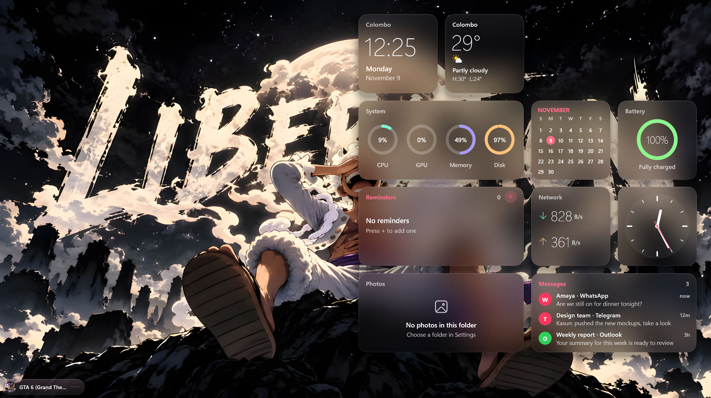
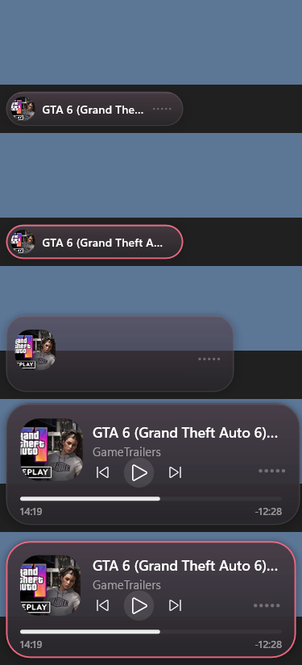
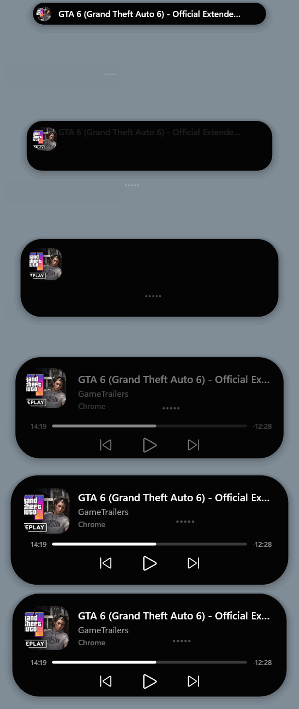
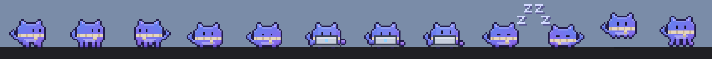
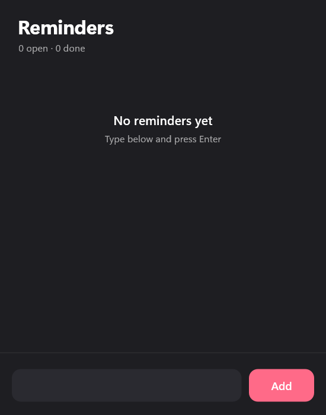
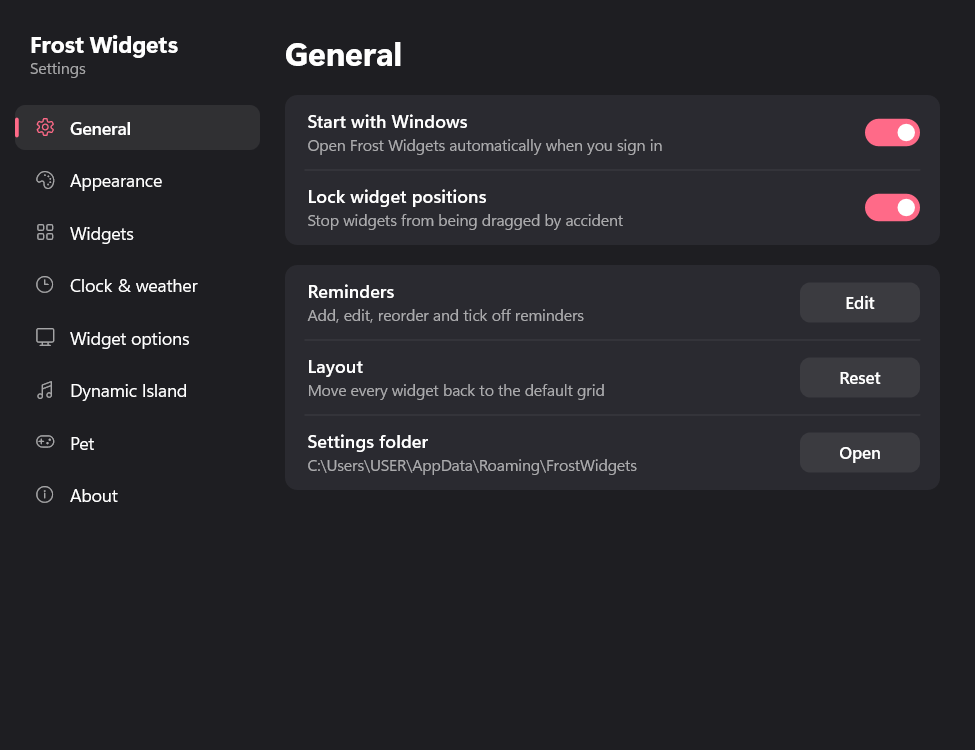
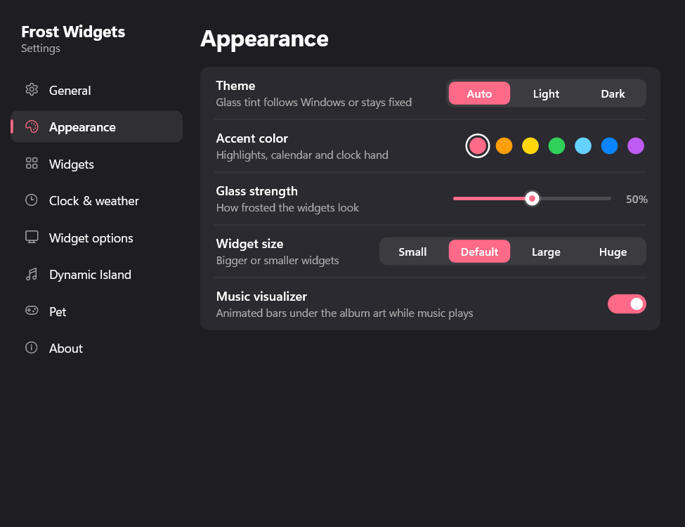
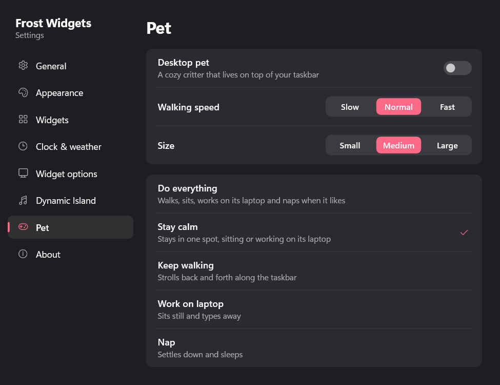

# Frost Widgets

Tiny macOS-style glass desktop widgets for Windows 10 and 11. Native Rust and Direct2D, with no browser engine.



**Widgets:** clock, weather, now playing (any app or browser), system rings, calendar, battery, reminders, network, analog clock, photos, messages, plus a desktop pet that lives on the taskbar.

## Features

| | |
|---|---|
| **Glass widgets** | Frosted panels tinted from your wallpaper, with a theme, accent color and glass strength you control. |
| **Now playing** | Album art, title, progress and transport controls for any media app, read from Windows media events. |
| **Dynamic Island** | A pill near the taskbar that shows what's playing, with its own settings tab. |
| **Desktop pet** | A pixel critter that walks, sits, works on its laptop and naps on the taskbar. |
| **Reminders** | Add, edit, reorder and tick off reminders right on the desktop. |
| **Light on resources** | Event-driven, with no render loop. See [Why it's light](#why-its-light). |

## Screenshots

### Now playing on the taskbar

The taskbar strip shows the track in its compact form. It expands into a full player when there's room.



### Dynamic Island



### Desktop pet



### Reminders editor



### Settings

Right-click any widget or the tray icon, then choose **Settings**.

| General | Appearance | Pet |
|---|---|---|
|  |  |  |

The Settings window has eight tabs: **General**, **Appearance**, **Widgets**, **Clock & weather**, **Widget options**, **Dynamic Island**, **Pet** and **About**.

## Install

Run `dist\FrostWidgets-Setup-<version>.exe`. The installer is under 1 MB.

- It installs for the current user only, to `%LOCALAPPDATA%\Programs\Frost Widgets`, so no admin prompt appears.
- It adds a Start menu shortcut, plus optional desktop and startup shortcuts.
- The app appears in **Settings › Apps › Installed apps**, where you can uninstall it.
- Silent install: `FrostWidgets-Setup-<version>.exe --silent`
- Silent uninstall: `uninstall.exe --uninstall --silent`

Uninstalling keeps your settings and reminders unless you tick **Also delete my settings and reminders**.

## Use

- **Settings:** right-click any widget or the tray icon, then choose **Settings**.
- **Reminders:** press **+** on the Reminders widget.
- **Move a widget:** drag it. It snaps to an 8px grid when you release it. Turn on **Lock widget positions** in General to stop accidental drags.
- **Desktop pet:** a small blue-and-purple pixel critter in a knit scarf lives on top of the taskbar. It walks, sits, types on its laptop and naps.
  - Click it to make it hop.
  - Drag it to carry it. It drops back onto the taskbar.
  - Right-click it to change its behavior (Do everything, Stay calm, Keep walking, Work on laptop, Nap), its walking speed and its size, or to hide it.
  - The same options are under **Settings › Pet** and in the tray menu.
  - It hides while an app is full screen, and it falls asleep after you've been away for 10 minutes.

Settings live in `%APPDATA%\FrostWidgets` (`config.toml` and `notes.txt`).

## Build

You need Rust (GNU toolchain) and `windres` on your PATH, for the icon and version info.

```powershell
.\build-setup.ps1
```

This builds `frost.exe`, compresses it into the installer and writes `dist\FrostWidgets-Setup-<version>.exe`.

For quick development runs:

```powershell
cargo build --release --bin frost
.\target\release\frost.exe
```

To render every widget, the reminders editor and every settings tab to PNG files and exit:

```powershell
.\target\release\frost.exe --snapshot preview.png
```

## Why it's light

- Event-driven: nothing redraws unless what it shows has changed. There is no render loop.
- Glass blur is computed once from the wallpaper, not every frame.
- Software Direct2D (no GPU device), one process, one UI thread.
- It pauses when the display is off, the PC is locked, or a maximized or full-screen app covers the widgets.
- Settings and reminders windows exist only while they are open.
- Media info comes from Windows media events. Weather uses the built-in `curl.exe` every 30 minutes.
